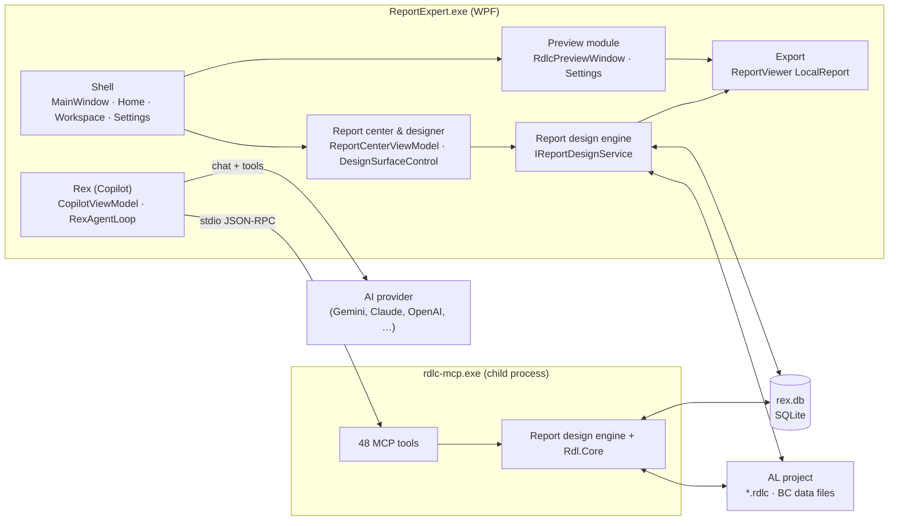
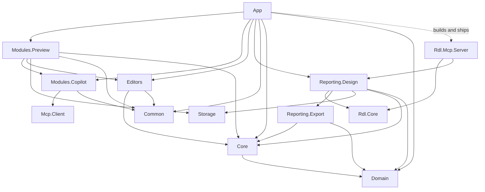
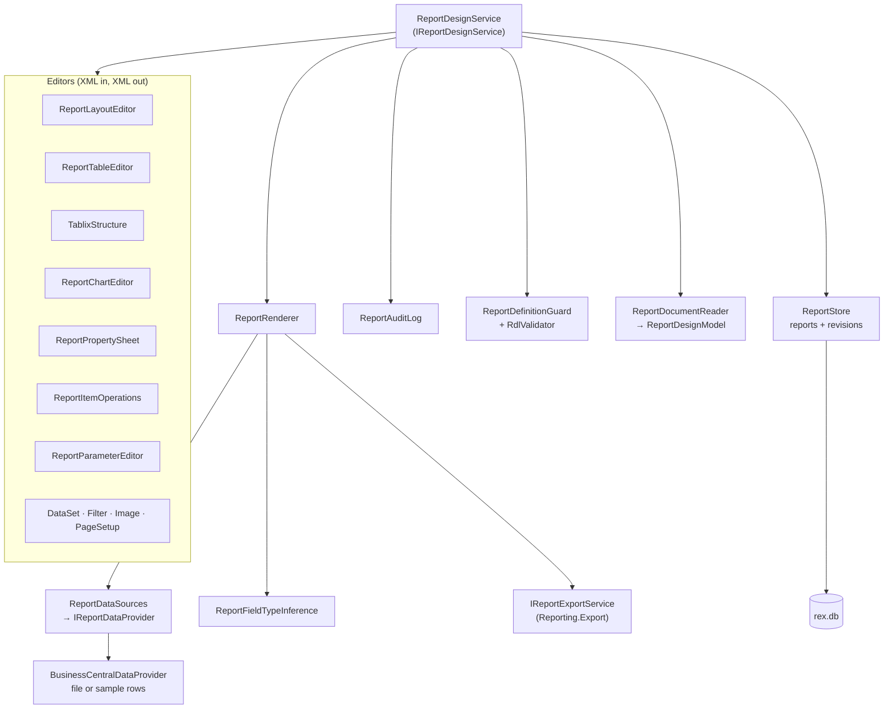
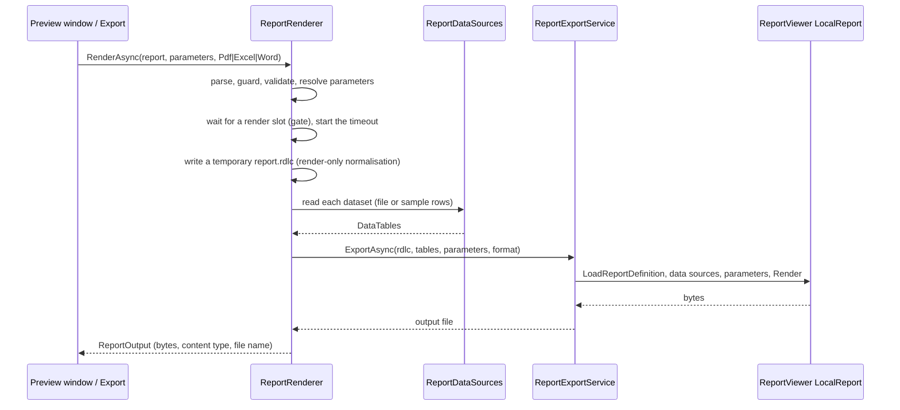
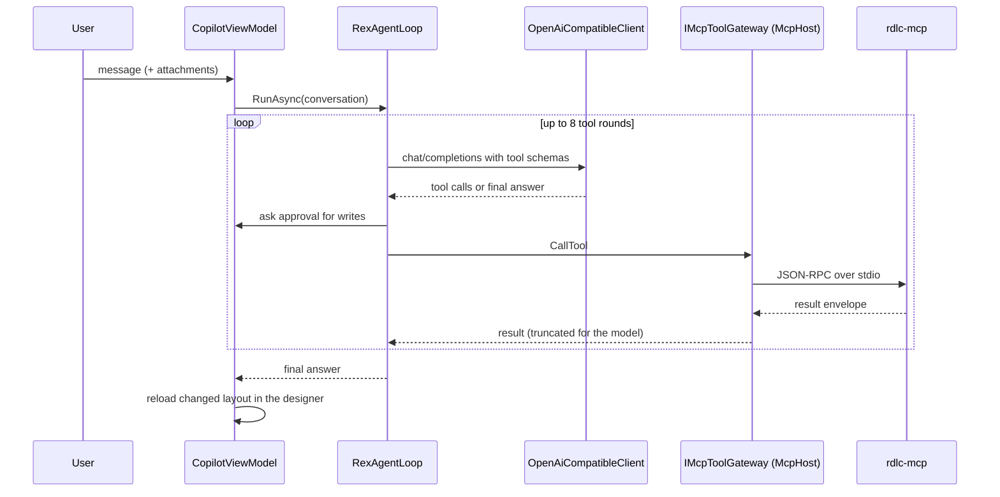
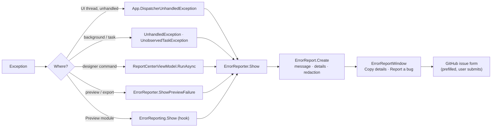

# Architecture

Report Expert (REX) 2.0 "Baboon" is a Windows desktop application (.NET 10, WPF) for designing, previewing
and editing Business Central RDLC layouts. This page explains how it is built: the projects and their
dependencies, the runtime pieces, the main data flows, and where a change belongs.

Companion documents: [DATABASE.md](DATABASE.md) (storage), [McpServer.md](McpServer.md) (agent tools),
[AI.md](AI.md) (Rex), [ReportBuilderParity.md](ReportBuilderParity.md) (designer scope),
[TESTING.md](TESTING.md).

## Goals and principles

- **Business Central first.** A layout saved by REX must still be a valid BC layout: the dataset
  (`DataSet_Result`), its empty `CommandText`, the `DataSource`, the `<Code>` block and `rd:` metadata are never
  rewritten.
- **One engine, many front ends.** The visual designer, the MCP server (agents) and Rex all edit layouts
  through the same `IReportDesignService`. A rule (for example how a tablix group is added) exists once.
- **Every change is a revision.** Each engine call that changes a layout stores one revision, so undo, redo
  and history work the same for clicks, agent tool calls and Rex edits.
- **The report processor is the judge.** Structural edits keep the RDL valid for ReportViewer, and tests
  render the result.
- **Local and private.** All data is on the user's machine; nothing leaves it except what the user sends to
  an AI provider or chooses to submit as a GitHub issue.
- **Clean room.** Microsoft Report Builder was studied for behaviour only (see [REA.md](REA.md)); no
  third-party code, icons or branding are copied.

## System overview



## Solution map

The solution is `ReportExpert.slnx`. Shared build settings are in `Directory.Build.props` (version,
nullable, language version) and package versions in `Directory.Packages.props` (central package
management).

### Live projects (shipped in 2.0)

| Project | TFM | Layer | Responsibility |
| --- | --- | --- | --- |
| `ReportExpert.App` | net10.0-windows | Shell | Entry point (`ReportExpert.exe`), main window and navigation, Home, workspace explorer, report center and designer UI, preview window/panel, error dialog, theming, MCP hosting |
| `ReportExpert.Modules.Preview` | net10.0-windows | Module | Settings page, RDLC preview window (1.0 path), sample data generator, BC XML renderer, Word/Excel layout preview, recent files |
| `ReportExpert.Modules.Copilot` | net10.0-windows | Module | Rex: chat UI, providers, model catalogue, `ProviderProbe`, agent loop, tool approval, attachments, dictation, settings (`copilot.json`, DPAPI) |
| `ReportExpert.Editors` | net10.0-windows | Module | AL source viewer (AvalonEdit + TextMate grammar) |
| `ReportExpert.Reporting.Design` | net10.0 | Engine | `IReportDesignService`: report store, revisions, layout/table/tablix/chart/property editors, data providers, type inference, validation, rendering |
| `ReportExpert.Reporting.Export` | net10.0 | Engine | `IReportExportService`: binds `DataTable`s and parameters to ReportViewer's `LocalReport`, renders PDF, Excel, Word |
| `ReportExpert.Storage` | net10.0 | Infrastructure | `RexDatabase`: the SQLite database, schema migrations, settings and recent-item access |
| `ReportExpert.Rdl.Core` (`src/mcp`) | net10.0 | Engine | RDL document model: parse, navigate, edit, validate, serialize (`RdlDocument`, `TablixNavigator`, `RdlValidator`) |
| `ReportExpert.Rdl.Mcp.Server` (`src/mcp`) | net10.0 | Tool server | `rdlc-mcp`: MCP server over stdio exposing read, edit, design and tablix tools; backups |
| `ReportExpert.Mcp.Client` (`src/mcp`) | net10.0 | Infrastructure | MCP client: server definitions (`mcp-servers.json`), process launch, `IMcpToolGateway` |
| `ReportExpert.Common` | net10.0 | Shared | `AppConstants`, `ThemeNames`, `ProjectLinks`, `ErrorReport`, `ErrorReporting` |
| `ReportExpert.Core` | net10.0 | Shared | Interfaces used by the shell and editors (workspace, editor services) |
| `ReportExpert.Domain` | net10.0 | Shared | Plain models (workspace snapshots, documents) |

### Live projects and scaffolding

These projects build but are **not referenced by the app**. They are kept for planned consolidation (see
[Roadmap.md](Roadmap.md)); a change there does not reach users.

| Project | Status |
| --- | --- |
| `ReportExpert.Application`, `ReportExpert.Infrastructure`, `ReportExpert.Plugins`, `ReportExpert.Shared` | DI/plugin scaffolding |
| `ReportExpert.Reporting.DummyData`, `.Expressions`, `.Parser`, `.Renderer` | Parallel libraries (Parser has tests); the Preview module keeps its own live versions |
| `ReportExpert.Modules.Localization` | Label/CSV editor, not wired into navigation |
| `ReportExpert.RdlcDesigner` | The 1.0 minimal designer; replaced by the report center designer (not in the solution) |

### Dependencies between live projects



Rules that keep this graph acyclic:

- Modules never reference the App; the App wires them together (`ShellCoordinator`, `MainWindow`).
- Copilot depends on `IMcpToolGateway`, never on the RDLC server, so a tool server is configuration.
- The engine (`Reporting.Design`, `Rdl.Core`, `Export`, `Storage`) has no WPF dependency and targets
  `net10.0`, so it runs and is tested on Linux (except PDF rendering, which needs GDI+).
- Libraries without UI report errors through `ErrorReporting.Handler` (in Common), which the App sets.

## The shell

`App` (`App.xaml.cs`) registers the code-page encoding provider (BC layouts use `Chr(…)` with Windows code
pages), installs the global exception handlers, connects `ErrorReporting` to the error dialog and applies
the saved theme.

`MainWindow` composes the UI:

| Area | Contents |
| --- | --- |
| App bar | Product name, open workspace, theme switch, Settings |
| Navigation drawer | Home and Settings; collapsible to icons |
| Workspace explorer | The AL project's RDLC layouts, AL files, Word and Excel layouts (`WorkspaceService`) |
| Home | The file opened from the workspace: the report center designer for RDLC (`ReportCenterView`, embedded), the AL viewer, Word/Excel preview; side tools: Properties, Rex, Outline |
| Settings | `SettingsView` from the Preview module |

`ShellCoordinator` connects the pieces that would otherwise need to know each other: the workspace root for
Rex's chat history, the report Rex works on, AL source lookups, and the MCP host. `McpHost` starts the
servers in `mcp-servers.json` (the bundled `rdlc-mcp` by default) and hands Rex an `IMcpToolGateway`.

Services are created by the shell; the report engine is the one part built with
`Microsoft.Extensions.DependencyInjection`:

```csharp
_reportServices = new ServiceCollection()
    .AddSingleton(typeof(ILogger<>), typeof(NullLogger<>))
    .AddReportDesign(options => options.SampleRows = SampleRowsSetting())
    .BuildServiceProvider();
```

### Theming

`SafiThemeManager` applies a `SafiPalette` (System, Light, Dark, Aquatic, Desert, Dusk, Night Sky) as
`Safi.*` brushes and pushes the colours into WPF-UI's accent, background, card and text resources, so
WPF-UI controls and REX's own styles (`Theming/SafiStyles.xaml`) follow one palette.

## The report design engine

`ReportExpert.Reporting.Design` is the heart of REX. Its public surface is `IReportDesignService`
(registered by `AddReportDesign`), whose methods take a report id and return a fresh `ReportDesignModel`.



### An edit, end to end

1. The front end calls, for example, `AddGroupAsync(id, new TablixGroupInsert(...))`.
2. `ReportDesignService` loads the current definition from `ReportStore` and parses it into an `RdlDocument`
   (`Rdl.Core`).
3. The editor changes the XML (`TablixStructure.AddGroup`), keeping the processor's rules (header levels,
   corner, `KeepWithGroup` runs, spans).
4. `ReportDefinitionGuard.EnsureSafe` checks the policy and size limits; `RdlValidator` checks references.
   A rejection is a `ReportDesignException` whose message is a `ReportCodes` value and whose `Detail` is in
   the engine's words.
5. `ReportStore.SaveAsync` stores the new revision (see [DATABASE.md](DATABASE.md#how-revisions-work)).
6. `ReportDocumentReader.Read` builds the `ReportDesignModel` the UI draws.

### The design model

`ReportDesignModel` is what every front end sees: report name, revision, `CanUndo`/`CanRedo`, datasets and
fields, parameters, images, page setup (`DesignPageSetup`), validation issues, and `Items`.

Each `DesignItem` carries:

- kind, name, band (`Body`, `Header`, `Footer`), position and size **relative to its container**, as RDL
  stores them;
- `OffsetLeftInches` / `OffsetTopInches` and `Container`: where its rectangle or tablix cell starts in the
  band. The designer draws at `AbsoluteLeftInches` / `AbsoluteTopInches` and subtracts the offset when an
  item is moved. Business Central list layouts nest whole pages inside a list cell, so without this their
  contents would be drawn on top of each other;
- `Style` (`DesignTextStyle`): font family and size, bold, italic, underline/strikeout, colour, background,
  text and vertical alignment, border — the static values (expressions only have values at run time);
- for a tablix: `Grid` (`DesignTablixGrid`: column widths, row heights, corner, header and body cells with
  spans, each cell with its own `Style`) and the row and column hierarchies (`DesignMember`) for the
  grouping pane.

### Properties and applicability

`ReportPropertySheet` defines the properties per item kind (text box, tablix, rectangle, image, chart,
report, page), each with a getter and a setter on the XML. The Properties pane shows only what applies to
the selection and leaves out what the format toolbar already offers. `ReportItemOperations.Applicable(count)`
lists the arrange operations that apply to the number of selected items (align needs two, spacing needs
three), so the UI never offers a command the engine would reject.

### Data for preview and export

`ReportDataSources` resolves each dataset's provider from its command (`ReportDataCommand`). A Business
Central dataset (no `rex:` command) goes to `BusinessCentralDataProvider`:

1. the data file attached to the report (`reports.data_file`), else
2. a file next to the `.rdlc` with the same name and `.xml`, `.json` or `.csv`, else
3. **sample rows**: `ReportingOptions.SampleRows` rows (Settings › Preview › Sample data, 1–500), with values
   from each field's type — numbers, dates, True/False, a 240×180 "Sample image" PNG for pictures, readable
   text for captions.

Untyped BC fields get a type from `ReportFieldTypeInference`, which reads how the layout uses each field
(aggregates, conversions, comparisons, Hidden expressions, image sources). The BC XML reader understands the
`DataItems` format BC writes from a request page and flattens nested data items as the BC runtime does.

### Rendering



On failure the renderer wraps the processor's exception in `ReportDesignException(RenderFailed)` whose
`Detail` is `ReportFailure.Describe` (the ReportViewer messages without generic wrappers) plus
`ReportFailure.ExplainExpression`: when the message names an expression ("The Hidden expression for the
tablix 'table2' …"), the expression is quoted from the layout with the fields it reads, their type and how
many rows are empty.

The Preview module's `RdlcPreviewWindow` (opened from the workspace) is the 1.0 preview path: it builds its
own `DataTable`s (`DummyDataGenerator`, `BcXmlReportRenderer`) and renders with ReportViewer directly.

## The designer front end

`ReportCenterViewModel` (App, split into `.Designer`, `.Tablix` and `.Workbench` partials) owns the open
report, the selection, the format toolbar state, the property sheet and the commands. Every command runs
through `RunAsync`, which shows the busy state, turns a `ReportDesignException` into a status message (or the
error dialog for render, definition and data failures), and shows the error dialog for anything unexpected.

`DesignSurfaceControl` draws the model on a WPF `Canvas`:

- rulers in the report's units, grid, bands with resizable edges, blank-page limit line;
- items at their absolute positions with their formatting. Black text and white backgrounds (the RDL
  defaults) use theme colours so layouts stay readable on dark themes; other colours are drawn as they render;
- tablix grids with corner, headers, merged cells and per-cell fonts that fit thin BC rows;
- interaction: select, multi-select, drag with snaplines (`ReportSnapper`), resize, keyboard nudge, drop from
  the toolbox and the Report data pane, cell selection and the tablix cell menu.

Dialogs (`TablixDialogs`, `PageSetupDialog`, `ExpressionEditorDialog`, `ReportParametersDialog`) and the
preview (`ReportPreviewWindow`, `ReportPreviewPanel`, `ExportMenu`) are in `App/Reports`.

## Rex (Copilot)



- **Providers.** All eight providers are called through the OpenAI-compatible `/chat/completions` API
  (`CopilotProviderDefaults` holds base URLs, key pages and the model catalogue). Claude also gets its
  `x-api-key` and `anthropic-version` headers; Azure uses `api-key` and deployment URLs.
- **Key test.** `ProviderProbe` sends a one-line request, classifies the answer (`Works`, `KeyRejected`,
  `ModelUnavailable`, `Busy`, `QuotaExceeded`, `Failed`), reads the key's `/models` list and, when the chosen
  model cannot be used, tries the recommended models the key offers. Provider error bodies are read whether
  they are objects or arrays.
- **Resilience.** The chat client retries once without `temperature` when a reasoning model rejects it, and
  explains a retired model instead of showing the raw error.
- **Settings.** `CopilotSettingsService` keeps several provider profiles in `copilot.json`; API keys are
  encrypted with DPAPI (`ApiKeyProtector`).

## The MCP server

`rdlc-mcp` (`Rdl.Mcp.Server`) is an MCP server over stdio built with the `ModelContextProtocol` SDK. It
exposes 48 tools in groups (read, layout, columns, datasets, parameters, backups, design, tablix). Design and
tablix tools call the same `IReportDesignService` as the designer. Every write supports `dry_run` (returns a
diff and steps the workspace back) and backs up the file first (`.rdlc-backups`). Allowed roots, backups and
retention are set with `RDLC_MCP_ALLOWED_ROOTS`, `RDLC_MCP_BACKUPS`, `RDLC_MCP_BACKUP_RETENTION`; the
workspace with `REX_DESIGN_WORKSPACE`. Details: [McpServer.md](McpServer.md) and the server README.

## Errors and diagnostics



- `ErrorReport` builds the message and the details: REX version, OS, .NET, culture, operation, summary and the
  exception chain with stack traces. `Redact` replaces the user profile path and user name and masks API keys
  and tokens.
- `ErrorReporter.Show` never throws, works from any thread and suppresses repeats of the same error within
  three seconds.
- Expected rejections (an invalid value, a missing parameter) stay in the status bar; failures of the report
  itself (render, definition, data) and defects open the dialog.
- **Report a bug** opens `ProjectLinks.NewIssue(bug_report.yml, …)` with the fields prefilled (cut to stay
  under GitHub's URL limit) and copies the full details to the clipboard.

## Storage

One SQLite database (`%LocalAppData%\ReportExpert\rex.db`) for settings, recent items and the design
workspace; `copilot.json` and `mcp-servers.json` in `%AppData%\ReportExpert`; chat history in the project's
`.report_expert` folder; `.bak` and `.rdlc-backups` next to layouts. Schema, revisions and migrations:
[DATABASE.md](DATABASE.md).

## Concurrency

- UI work runs on the WPF dispatcher; engine calls are `async` and do file and database work without blocking
  it. ReportViewer rendering runs on the thread pool (`Task.Run`).
- `ReportRenderer` allows two renders at once (a semaphore) with a timeout
  (`ExecutionTimeoutSeconds`, at most 120 s).
- `ReportStore` serializes writes in the process; SQLite WAL and the busy timeout let the app and `rdlc-mcp`
  use the same database.
- Settings auto-save is debounced (350 ms).

## Security

| Concern | Measure |
| --- | --- |
| API keys at rest | DPAPI, current Windows user (`ApiKeyProtector`) |
| Keys and paths in error reports | `ErrorReport.Redact` |
| Layout code | The desktop uses `ReportSafetyPolicy.Trusted`: a layout's `<Code>` runs during preview, as in BC, so layouts should come from trusted sources. `Strict` (embedded data sources only, no custom code) exists for hosting the engine; size and item limits apply in both |
| Agent edits | Tool approval for writes in Rex; `dry_run`, backups and allowed roots in `rdlc-mcp` |
| Dependencies | Central package versions; vulnerable transitive packages pinned (`System.Security.Cryptography.Pkcs/Xml` 10.0.13) |
| Data leaving the machine | Only Rex requests to the chosen provider, and GitHub issues the user submits |

Report vulnerabilities as described in [SECURITY.md](../SECURITY.md).

## Build, versioning and packaging

- `dotnet build ReportExpert.slnx` (Windows). On Linux, `-p:EnableWindowsTargeting=true` builds the WPF
  projects for checking; the engine test projects run there.
- `Directory.Build.props` holds `Version` (2.0.0), `VersionDisplay` (2.0), `VersionCodename` (Baboon) and
  `InformationalVersion` (`rex-2.0-baboon`), which the app shows in Settings and error reports.
- `scripts\build-release.ps1` publishes a self-contained win-x64 build and produces the portable ZIP, the Inno
  Setup installer (`installer/ReportExpert.iss`) and the MSIX package (`installer/msix`), named
  `v{VersionDisplay}-{VersionCodename}`.
- Release history: [CHANGELOG.md](CHANGELOG.md). Release notes: [v2.0-Baboon.md](v2.0-Baboon.md).

## Testing

| Project | Runs on | Covers |
| --- | --- | --- |
| `Reporting.Design.Tests` | any OS | BC contract, revisions, tablix grouping and fuzzing, nested placement, text styles, sample rows, type inference, expression failures, rendering (PDF on Windows) |
| `Rdl.Core.Tests` | any OS | RDL parsing, editing, validation |
| `Rdl.Mcp.Server.Tests` | any OS | Every MCP tool, dry runs, backups |
| `Common.Tests` | any OS | Error reports, redaction, issue links |
| `Storage.Tests`, `Reporting.Parser.Tests` | any OS | Database, parser |
| `Mcp.Client.Tests` | Windows (3 path tests) | Server configuration and launch |
| `Modules.Copilot.Tests`, `Modules.Preview.Tests` | Windows | Providers, settings, key encryption, probe; preview services |

See [TESTING.md](TESTING.md).

## Where a change belongs

| To change… | Edit… | Avoid… |
| --- | --- | --- |
| How a layout is edited (any front end) | An editor in `Reporting.Design` + a method on `IReportDesignService` | Editing RDL XML in the App or in a tool |
| What the designer draws or how it reacts | `App/Reports` (`DesignSurfaceControl`, `ReportCenterViewModel.*`) | Adding layout rules there |
| A property in the Properties pane | `ReportPropertySheet` | Hard-coding it in XAML |
| What the design model exposes | `ReportDocumentReader`, `ReportModels`, `TablixModels`, `DesignTextStyle` | |
| Preview data, sample rows, BC files | `BusinessCentralData.cs`, `ReportFieldTypeInference` | The 1.0 Preview module generators (they only serve `RdlcPreviewWindow`) |
| An agent tool | `Rdl.Mcp.Server/Tools` calling the engine | Duplicating engine logic |
| Rex providers, models, the key test | `Modules.Copilot` (`CopilotProvider.cs`, `ProviderProbe`, `OpenAiCompatibleClient`) | Provider code in the App |
| Settings page | `Modules.Preview/Views/SettingsView.xaml` + `SettingsViewModel` | |
| The database schema | `RexDatabase.Migrate` (new version step) + `Storage.Tests` | Editing an existing step |
| Error handling | `ErrorReport`, `ErrorReporter`, `ReportFailure` | Message boxes |
| Version or codename | `Directory.Build.props` (+ CHANGELOG) | Version strings in code |

## Things not to change casually

- Business Central contract handling (`ReportDataCommand`, `ReportDefinitionGuard`, the BC data reader).
- MCP tool names and result envelopes — agents and tests depend on them.
- Database schema steps and `RexStorageKeys` — users already have the data.
- The file names in `AppConstants` (`copilot.json`, `mcp-servers.json`) and the DPAPI entropy in
  `ApiKeyProtector` (changing it makes stored keys unreadable).
- Anything under `Microsoft.RdlcDesigner/` — reference only, not redistributable.
