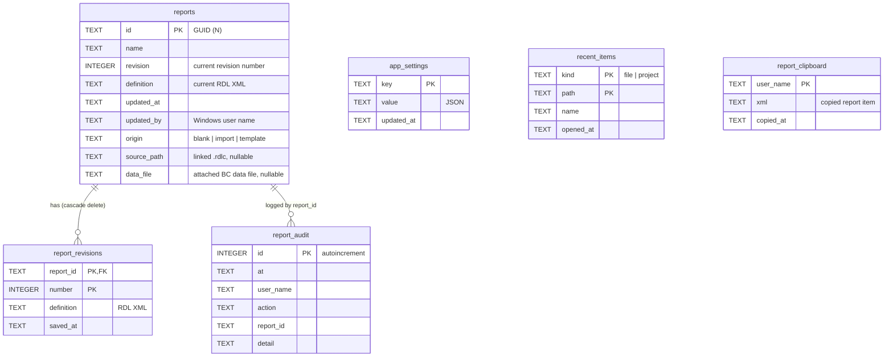
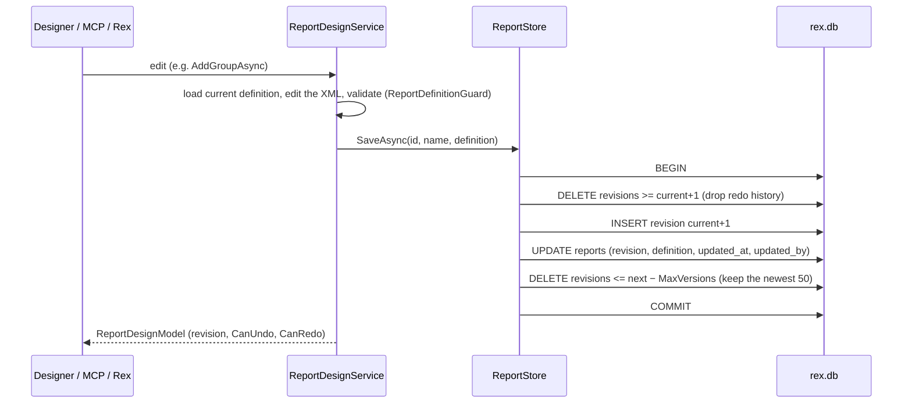

# Data storage and database

Report Expert keeps its own data in **one SQLite database** and a few files. This page describes every place
REX reads or writes, the database schema, how revisions work, how the schema is upgraded, and how to back up,
inspect or reset the data.

The RDLC layouts themselves are **not** stored in the database as the source of truth: they belong to the
AL project and are read from and saved back to the `.rdlc` files.

## At a glance

| What | Where | Format | Owner (code) |
| --- | --- | --- | --- |
| App settings, recent files and projects, report workspace | `%LocalAppData%\ReportExpert\rex.db` | SQLite (WAL) | `ReportExpert.Storage.RexDatabase` |
| AI provider settings and API keys | `%AppData%\ReportExpert\copilot.json` | JSON, keys encrypted (DPAPI) | `Modules.Copilot` `CopilotSettingsService` |
| MCP servers to launch | `%AppData%\ReportExpert\mcp-servers.json` | JSON | `Mcp.Client` `McpServerDefinition` |
| Rex chat history | `<project>\.report_expert\chat\<report>.<hash>.json` | JSON | `Modules.Copilot` `CopilotChatHistoryStore` |
| Previous version of a saved layout | `<layout>.rdlc.bak` beside the layout | RDLC | `ReportDesignService.SaveToFileAsync` |
| MCP server backups | `<layout folder>\.rdlc-backups\*.bak` (newest 20 per report) | RDLC | `Rdl.Mcp.Server` `BackupStore` |
| Preview PDFs, render scratch files | `%TEMP%\ReportExpert\Preview`, `%TEMP%\rex-report\<guid>` | PDF, RDLC | Preview panel/window, `ReportRenderer` (deleted after use) |
| WebView2 profile for the PDF viewer | `%AppData%\ReportExpert\WebView2` | Edge profile | Preview panel/window |
| Custom design workspace (MCP server, tests) | `<StoragePath>\rex.db` | SQLite | `ReportWorkspaceContext` |

`%LocalAppData%` is machine-local (`C:\Users\<you>\AppData\Local`); `%AppData%` is the roaming profile
(`C:\Users\<you>\AppData\Roaming`).

## The SQLite database (`rex.db`)

`RexDatabase` (project `src/ReportExpert.Storage`) opens the file through `Microsoft.Data.Sqlite`. SQLite runs
in-process, so there is no server to install.

Every connection applies:

```sql
PRAGMA journal_mode = WAL;     -- readers and one writer at the same time (app + rdlc-mcp)
PRAGMA foreign_keys = ON;      -- report_revisions cascade with their report
PRAGMA busy_timeout = 5000;    -- wait up to 5 s for a lock instead of failing
```

Connections are pooled with a shared cache. `RexDatabase.At(path)` keeps **one instance per file per
process**, so the schema check runs once. All timestamps are stored as ISO 8601 UTC text (`"O"` format);
report ids are GUIDs in `N` format (32 hex digits, no dashes).

### Entity diagram



### Tables

#### `app_settings` — key/value settings as JSON

| Column | Type | Notes |
| --- | --- | --- |
| `key` | TEXT, primary key | See the keys below |
| `value` | TEXT, not null | JSON (`System.Text.Json`) |
| `updated_at` | TEXT, not null | Last write |

Keys in use (`RexStorageKeys`):

| Key | Value |
| --- | --- |
| `app.settings` | `AppSettings` from `Modules.Preview`: `Theme`, `RowsGenerated` (sample rows, 1–500), `FontSize`, `RememberRecentFiles`, `MaxRecentFiles`, `AutoPreview`, `AlSourcePanelVisible`, `AlSourcePanelWidth`, `ShowDesignerRulers`, `ShowDesignerGridlines`, `DefaultExportFolder` (now the folder last exported to) |
| `migration.legacy-files.recent-files` | Time the 1.0 `recent.json` was imported |
| `migration.legacy-files.recent-projects` | Time the 1.0 `recent-projects.json` was imported |
| `migration.legacy-files.reports` | Time the older folder-based report workspace was imported |

Write: `SetJson` is an upsert (`INSERT … ON CONFLICT(key) DO UPDATE`). Settings are written about 350 ms
after the last change in the Settings page (debounced auto-save).

#### `recent_items` — recent layouts and projects

| Column | Type | Notes |
| --- | --- | --- |
| `kind` | TEXT, primary key part | `file` (recent layout) or `project` (recent AL project folder) |
| `path` | TEXT, primary key part | Full path |
| `name` | TEXT | Display name |
| `opened_at` | TEXT, not null | Last opened; lists are ordered by it, newest first |

`ReplaceRecentItems(kind, items)` rewrites one kind in a transaction.

#### `reports` — one row per report in the design workspace

| Column | Type | Notes |
| --- | --- | --- |
| `id` | TEXT, primary key | GUID (`N`) |
| `name` | TEXT, not null | Report name shown in the report center |
| `revision` | INTEGER, not null | The revision the report is at now (moves with undo/redo) |
| `definition` | TEXT, not null | The RDL XML of that revision (a copy, for fast loading) |
| `updated_at`, `updated_by` | TEXT, not null | Last change and the Windows user who made it |
| `origin` | TEXT | `blank` (new report), `import` (opened from an `.rdlc`), `template` (starter layout) |
| `source_path` | TEXT, indexed (`ix_reports_source`) | The linked `.rdlc` the report saves back to; null for workspace-only reports |
| `data_file` | TEXT | Attached BC XML/JSON/CSV used for preview; null means a same-named sibling file or sample data |

#### `report_revisions` — the stored history

| Column | Type | Notes |
| --- | --- | --- |
| `report_id` | TEXT, primary key part, FK → `reports(id)` `ON DELETE CASCADE` | |
| `number` | INTEGER, primary key part | 1, 2, 3, … |
| `definition` | TEXT, not null | Full RDL XML of that revision |
| `saved_at` | TEXT, not null | |

#### `report_audit` — what was done

| Column | Type | Notes |
| --- | --- | --- |
| `id` | INTEGER, primary key, autoincrement | |
| `at` | TEXT, not null | |
| `user_name` | TEXT, not null | Windows user |
| `action` | TEXT, not null | `Created`, `Imported`, `Installed` (templates), `Saved`, `SavedToFile`, `Reloaded`, `Renamed`, `Rendered`, `Downloaded`, `Deleted` |
| `report_id` | TEXT, not null | Not a foreign key, so the log survives a deleted report |
| `detail` | TEXT | For example the report name or output format |

#### `report_clipboard` — copy/paste of report items

| Column | Type | Notes |
| --- | --- | --- |
| `user_name` | TEXT, primary key | One clipboard per Windows user |
| `xml` | TEXT, not null | The copied item(s) as RDL XML |
| `copied_at` | TEXT, not null | |

The clipboard lives in the database (not the Windows clipboard), so when `rdlc-mcp` uses the default workspace
the designer and the MCP server can paste what the other copied.

### How revisions work

Every designer gesture, property change, MCP write and Rex edit is **one call** to `IReportDesignService`, and
each call that changes the layout stores **one revision**:



- **Undo / redo** (`StepAsync(-1 | +1)`) moves `reports.revision` to the previous or next stored row and copies
  its definition into `reports.definition`. `CanUndo` / `CanRedo` are "does revision ±1 exist".
- A new edit after an undo discards the redo branch (revisions above the current one).
- `ReportingOptions.MaxVersions` (default **50**, minimum 2) bounds the history per report.
- Writes to one store are serialized by a `SemaphoreSlim`; across processes, SQLite's lock and the 5 s busy
  timeout serialize them.
- **Save to file** writes the current definition to `source_path` atomically (temporary file, then replace)
  and keeps the previous file as `.bak`. Reopening a linked file that changed outside REX stores the file as a
  new revision (`Reloaded`).

### Schema versions and migrations

The schema version is `PRAGMA user_version`; `RexDatabase.SchemaVersion` is **1**. On every open,
`Migrate` reads the version and runs the missing steps in one transaction:

| Version | Change |
| --- | --- |
| 0 → 1 | Create all seven tables and `ix_reports_source` |

To change the schema: bump `SchemaVersion`, add an `if (version < N)` block with the `ALTER`/`CREATE`
statements, and add a test in `tests/ReportExpert.Storage.Tests`. Never edit an existing step: users already
ran it.

### Imports from older versions

Run once, each guarded by its `migration.legacy-files.*` key. The old files are read, never deleted.

| Source (1.0) | Imported into | Code |
| --- | --- | --- |
| `%AppData%\ReportExpert\settings.json` | `app_settings` / `app.settings` | `Modules.Preview` `SettingsService` |
| `%AppData%\ReportExpert\recent.json` | `recent_items` (`file`) | `RecentFilesService` |
| `%AppData%\ReportExpert\recent-projects.json` | `recent_items` (`project`) | `WorkspaceService` |
| `%LocalAppData%\ReportExpert\reports\<guid>\meta.json` + `report.rdlc` (+ revisions) | `reports`, `report_revisions` | `LegacyReportImport` |

### Separate databases

`ReportWorkspaceContext` uses the shared `rex.db` unless a custom `ReportingOptions.StoragePath` is set; a
custom workspace gets its own `<StoragePath>\rex.db`. The MCP server uses `REX_DESIGN_WORKSPACE` for this,
and the tests use a temporary folder per test.

## Files outside the database

### `copilot.json` — AI providers

```json
{
  "Provider": "Gemini",
  "Providers": [
    {
      "Provider": "Gemini",
      "ApiKey": "dpapi:AQAAANCMnd8BFdERjHoAwE/Cl+sBAAAA…",
      "Model": "gemini-3.5-flash",
      "BaseUrl": "",
      "AzureDeployment": "",
      "KeyStatus": "Valid",
      "KeyError": null
    }
  ],
  "AgentModeEnabled": false,
  "DisabledMcpTools": []
}
```

- `ApiKey` is encrypted with Windows DPAPI for the current user (`ApiKeyProtector`, scope `CurrentUser`,
  fixed entropy). It only decrypts for the same Windows user on the same machine; elsewhere it reads as empty
  and Settings shows "No API key".
- Plain-text keys written by 1.0 are accepted and encrypted on the next save. The 1.0 single-provider fields
  (`ApiKey`, `Model`, `BaseUrl`, `AzureDeployment` at the top level) are migrated into `Providers`.
- `KeyStatus` is `Unknown`, `Valid` or `Rejected`; a rejected provider is not offered in the Rex picker.

The file stays separate from `rex.db` on purpose: it is per Windows user (roaming), and the MCP server never
needs it.

### `mcp-servers.json` — tool servers

The servers `McpHost` starts as child processes for Rex. The bundled `rdlc-mcp` is written as an
app-relative command (`mcp/rdlc/rdlc-mcp.exe`) and repaired if an older build wrote an absolute debug path.
Example: [examples/mcp-servers.example.json](examples/mcp-servers.example.json).

### Chat history

One JSON file per report under the project's `.report_expert\chat` folder, named after the layout plus a hash
of its relative path, so history follows the project (and can be ignored in git with `.report_expert/`).

## Backing up, inspecting and resetting

- **Back up:** close REX (and any agent using `rdlc-mcp`), then copy `rex.db` together with `rex.db-wal` and
  `rex.db-shm` if they exist. Copy `copilot.json` only for the same Windows user (keys are bound to it).
- **Inspect:** open a *copy* of `rex.db` with any SQLite tool, for example
  `sqlite3 rex.db "SELECT name, revision, source_path FROM reports ORDER BY updated_at DESC;"`.
- **Reset settings:** delete the `app.settings` row, or delete `rex.db` to reset settings, recent items and the
  design workspace (linked `.rdlc` files are untouched; their REX history is lost).
- **Reset AI providers:** delete `copilot.json`.
- **Free space:** revisions are capped at 50 per report; deleting a report in the report center removes its
  revisions (cascade). `VACUUM` reclaims the space.

## Privacy

Everything above stays on the user's machine. REX sends data out only when the user uses Rex (the messages,
the report context it summarizes and attachments go to the chosen AI provider) or opens a GitHub link from the
error dialog (the prefilled issue contains the redacted error details, and nothing is sent until the user
submits the form).
